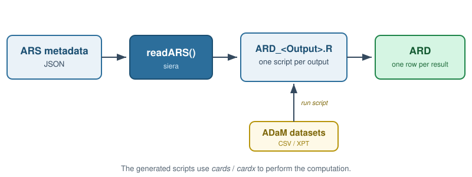

```{r, include = FALSE}
knitr::opts_chunk$set(
  collapse = TRUE,
  comment = "#>"
)
```

```{r setup}
library(siera)
```

This vignette steps back from the "how" (covered in the other vignettes) to explain the "why" behind _siera_: what an Analysis Results Dataset (ARD) is good for, how _siera_ fits into the workflow, and the conventions you will see in the generated scripts and their output.

## Why an ARD?

Traditionally, analysis results have lived inside static outputs - the numbers in an RTF or PDF table. An **Analysis Results Dataset (ARD)** instead stores those same results as _machine-readable data_, one row per result, with metadata describing exactly what each number is. Once results are data, several things become a lot easier:

- **QC** - results can be compared programmatically against an independent calculation, instead of by eye.
- **Re-use across outputs** - the same result can feed a table, a figure, or a listing without being re-calculated.
- **Re-use across reporting events** - results computed once can be carried into a later submission or a different deliverable.
- **Creating final TFLs** - downstream packages such as [`tfrmt`](https://gsk-biostatistics.github.io/tfrmt/) and [`gtsummary`](https://www.danieldsjoberg.com/gtsummary/) format ARDs straight into submission-ready tables.

_siera's_ job is to get you to an ARD without writing the analysis code by hand: you supply ARS metadata, and _siera_ writes the R that produces the ARD.

## The siera pipeline

```{r pipeline diagram, echo=FALSE, out.width="100%", fig.alt="ARS metadata is read by readARS(), which writes one R script per output; each script runs against ADaM datasets to produce an ARD."}

```

The flow is always the same:

1. You start with **ARS metadata** (the Analysis Results Standard description of your reporting event), as a JSON file.
2. You pass it to **`readARS()`**, which writes **one R script per Output** defined in the metadata.
3. You run a generated script against your **ADaM datasets** - supplied as CSV (`.csv`), SAS transport (`.xpt`) or CDISC Dataset-JSON (`.json`) files - and the result is an **ARD** - one row per result, ready for downstream use. siera reads each ADaM dataset according to its file extension (`.csv` with `readr::read_csv()`, `.xpt` with `haven::read_xpt()`, `.json` with `datasetjson::read_dataset_json()`), so no extra argument is needed.

The statistical computation itself is performed by the [`cards`](https://insightsengineering.github.io/cards/) and [`cardx`](https://insightsengineering.github.io/cardx/) packages, whose functions _siera_ writes into the generated scripts (see the vignette on [using `cards` and `cardx`](using-cards.html)).

## The seven ARS sections siera consumes

ARS metadata describes a whole reporting event, but _siera_ only needs seven sections to generate code. It is worth knowing what each one contributes:

| ARS section | What siera does with it |
|---|---|
| _mainListOfContents_ | Links each Output to its analyses, and sets the row order and indentation of the table stub. |
| _otherListsOfContents_ | Supplies Output-level metadata (the list of planned outputs). |
| _analysisSets_ | Defines a population filter (e.g. Safety Population, `SAFFL == "Y"`). Each analysis names its own, so one output can report several populations. A set with no condition (e.g. All Subjects) is the whole dataset, unfiltered. |
| _dataSubsets_ | Adds row-level filters for individual analyses (e.g. serious, treatment-emergent AEs). |
| _analysisGroupings_ | Defines the columns/subgroups results are split by (e.g. treatment arm), including data-driven groupings discovered at run time. |
| _analyses_ | Ties everything together for one calculation: which method, population, subset and groupings apply. |
| _methods_ | Describes the operations to perform, and carries the dynamic R code template _siera_ fills in (inline, or *referenced* from an external method library - see _Using cards_). |

Each generated script is assembled from these pieces, and every result it produces carries identifiers back to them (see "Reading an ARD row" below).

A method's code template need not be written inline: _siera_ can also resolve it from an external **reference document** (the ARS `codeTemplate.documentRef` mechanism), so an ARS file can point at a shared, tested method library by `id` rather than copy-pasting code. This builds on `referenceDocuments`, which is otherwise outside the seven sections above. See the _Using cards and cardx_ article for how to wire it up.

## ARS metadata is JSON

ARS metadata officially travels as JSON, and JSON is what _siera_ reads. Earlier releases also read an Excel (`.xlsx`) representation of the same information; that is now **deprecated**. `readARS()` still accepts a workbook for now, with a warning, by converting it to JSON in memory first, so you get the same generated scripts as from the equivalent JSON file. A future release will read JSON only.

If your ARS metadata lives in a workbook (for example a TFL Designer export), convert it once with `ars_xlsx_to_json()` and keep the `.json` file from then on. The converter is deprecated as well and will be removed together with `.xlsx` input. After that, CDISC's own `excel2ars.py` utility remains a route from Excel to ARS JSON.

## Reading an ARD row: CDISC traceability columns

A core promise of the ARD is _traceability_: every result can be traced back to the metadata that defines it. To make that possible, each row of a _siera_-generated ARD carries identifier columns alongside the statistic itself:

- **`AnalysisId`**, **`MethodId`** and **`OutputId`** - which analysis, method and output produced the row.
- **`operationid`** - which operation within the method (e.g. the `n` count vs. the `%`).
- For each grouping applied to the analysis, a set of `group[n]_*` columns:
  - **`group[n]_groupingId`** - the grouping the column belongs to (e.g. the treatment-arm grouping).
  - **`group[n]_groupId`** - for **pre-defined groups** (groups listed explicitly in the metadata), the identifier of the specific group.
  - **`group[n]_groupValue`** - for **data-driven groupings** (`dataDriven: true`, where the categories are discovered from the ADaM data at run time, e.g. cause of death or AE term), the actual value found in the data.

The distinction matters: a treatment-arm grouping is usually pre-defined, so its rows carry `group1_groupId`; a grouping such as "cause of death" is typically data-driven, so its rows carry `group1_groupValue` with whatever categories appeared in the data. A single ARD can contain both.

These columns are added by the last step of each analysis in the generated script, a call to `ars_stamp()` that takes every identifier from the ARS metadata (and says, in a comment, which ARS element it came from).  The [ARD program structure](ARD_script_structure.html) vignette shows this "ID linking" step in the generated code, and how to generate the plain `dplyr` equivalent instead with `readARS(code_style = "expanded")`.

### Which rows should exist? Pre-defined vs. data-driven categories

The two kinds of grouping also answer a question every table shell raises: _which rows belong in the output?_

For a **data-driven** grouping the data _is_ the row list. If no subject reported a given preferred term, that term simply has no row - there was nothing to discover.

For a **pre-defined** grouping the metadata is the row list, and it is fixed before any data is seen. Your shell says "Action taken: interrupted / reduced / delayed / other", so the table needs all four rows for every treatment arm, whether or not the study produced any of them - a category with no subjects is the clinically meaningful result `0 (0.0)`, not a missing line. Equally, a value that appears in the data but matches none of the defined groups (a stray `DRUG WITHDRAWN`, or a mis-spelled term) was never asked for, and does not belong in the output at all.

_siera_ follows the grouping's `dataDriven` flag. For a pre-defined grouping, the generated script first turns the grouping variable into a factor whose levels are the groups the ARS declares, in the declared `order`. `{cards}` then reports every level, with a zero count when no record falls in it, and data values that match no declared group are dropped before anything is counted. You can see this as a "Pre-defined groupings as ARS-ordered factors" step right after the data subset in each analysis. A group defined by a single value (`TRT01A EQ "Placebo"`) keeps that value as its label. A group defined by an `IN` list becomes one row, labelled with the group's name. If no record of a non-empty subset matches any declared group, the script warns: that almost always means the declared values and the data coding disagree, and a table of zeros would be the wrong answer. Two kinds of pre-defined grouping keep their observed values, and `readARS()` warns about each one: groupings that overlap (a "Total" arm defined as `TRT01AN NE ""` or as `IN` over all the arms, alongside the individual arms) and groupings built from ranges (`TRTDURM GT 0`). A grouping variable that the analysis's own data subset or analysis set restricts (say, a "treated subjects" population defined on the treatment variable) also keeps its observed values, without a warning: that slice leaves groups out on purpose, so they must not come back as zero rows. If you need the old behaviour, where the observed values always decide the rows, call `readARS(..., predefined_zero_fill = FALSE)`; this switch is temporary.

Two things can still stand between the declared groups and the ARD. First, the method template must leave the factor intact: a template that converts the grouping columns to character loses the zero rows and the declared order (see [using `cards` and `cardx`](using-cards.html)). Second, the method template must be able to run on an empty data subset. An analysis with a pre-defined grouping runs its method even when no record qualifies, so every declared group can read `0 (0.0)`. If the template cannot compute on zero rows (for instance because it tabulates a constant character column, which `cards` refuses when it has no values), the analysis reports a single row without statistics instead, and the script warns with the analysis id, the method id and the error, so an analysis that fell back to that row is never silent: read the error to tell a template that genuinely cannot run on zero rows from one that is broken.

Some methods do this work themselves. A method built on a pre-defined grouping (`categorical_summary_per_predefined_group` in the bundled [method-template library](using-cards.html), with its risk-difference and chi-square counterparts `risk_difference_per_predefined_group` and `chisq_per_predefined_group`) aggregates **per group condition**: it reports every group the metadata defines, zero-filled where the data is silent, and excludes values that satisfy no group condition. Because a group is defined by a condition rather than by a single value, a group covering several values at once (an `IN` condition, e.g. "Other" spanning three coded terms) is reported as one row. Tests such as `chisq` and the risk differences read the grouping variable directly rather than through the generic grouping valueSources, so the factor step does not apply to them. Use the pre-defined variant for the p-value too: testing the raw values of a variable whose groups merge several values gives a different p-value from the one that belongs to the reported rows. Pick the variant that matches your grouping's `dataDriven` flag.
